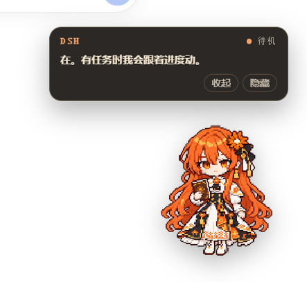

# claude-pet-dsh



把 Q 版 Claude 桌宠接进 **DeepSeek Harness（DSH）** 的 Web / Desktop 界面。它是一个 DSH 客户端插件：

- 在 `shell.overlay` 上显示右下角桌宠；
- 监听 DSH 的 `session/event`（turn / tool / approval / todo）和 `agent/error`；
- 展开时使用 `assets/spritesheet.webp` 的 8×9 角色图集（1536×1872，192×208 单元格）按状态播放动作；
- 最小化时缩成右下角的迷你 Clawd（`assets/svg/clawd-mini-*`），点一下展开回原角色；
- 气泡显示当前任务与 `completed/total` 进度；
- 可拖到窗口内任意位置，位置保存在浏览器 `localStorage`。

## 安装

```sh
git clone https://github.com/Jimesarrice/claude-pet-dsh.git
```

在 DSH 环境的终端中注册本地包（把 `<克隆目录>` 换成实际路径）：

```sh
dsh plugin --profile web add file:<克隆目录>
```

桌面版：

```sh
dsh plugin --profile desktop add file:<克隆目录>
```

如果桌面客户端对 desktop profile 有应用内专管限制，请在 DSH 桌面端的插件管理界面选择本地包，或按客户端提示安装。安装后需要重启 DSH（或重开页面）让插件层加载。

## 卸载

```sh
dsh plugin --profile web remove claude-pet-dsh
dsh plugin --profile desktop remove claude-pet-dsh
```

DSH 重启后生效。

## 使用

- 启动后右下角出现角色，默认位置距窗口右下角 24 px。
- 按住角色拖动可放到窗口内任意位置（横向、纵向都到边），松开后记住位置。
- 单击角色切换气泡；“收起”只隐藏气泡，“隐藏”把角色缩成右下角的迷你 Clawd（`MINI` 表映射 `clawd-mini-*`，并跟随当前状态），点它展开回原角色与动作动画，位置不变。
- 状态映射（展开态图集行号）：
  - `turn/start` → 工作（第 7 行）；
  - `tool/call` → 工作，`ask_user_question` → 等待（第 6 行）；
  - `approval/asked` → 等待；
  - `tool/result` → 工作；
  - `todo/write` → 更新任务标题与 `completed/total`；
  - `turn/end: completed` → 完成（第 4 行，8 秒后回到待机）；
  - `turn/end: error/max-tokens/timeout` → 出错（第 5 行）；
  - `turn/end: blocked` → 等待；
  - `agent/error` → 出错。
- 出错状态会一直保持，直到出现以下任一恢复：该会话有新事件（如新一轮 `turn/start`）；宿主发出会话关闭/删除类生命周期事件（插件已防御性订阅 `session/close|delete|disposed|removed`，宿主没有这些事件则无副作用）；或点气泡中的 **“本次错误已处理”** 按钮——报错的对话被归档后往往不会再有任何事件，这个按钮就是显式的解除入口，点击后桌宠立即回到待机。

宿主路由：`GET /claude-pet-dsh/state`、`POST /claude-pet-dsh/ack?session=<id>`、`/claude-pet-dsh/spritesheet.webp`、`/claude-pet-dsh/assets/svg/<name>.svg`、`/claude-pet-dsh/health`。

## 自定义角色

**展开态**：`assets/spritesheet.webp` 是 Petdex 兼容的 8×9 图集（1536×1872，192×208 单元格），行序：

0 idle、1 running-right、2 running-left、3 waving、4 jumping、5 failed、6 waiting、7 running、8 review。

替换该文件即可换角色；`client.js` 里的 `ROWS` 控制状态到行/帧数的映射。

**最小化态**：`assets/svg/` 里是 45×45 viewBox、自带 CSS 动画的迷你 Clawd，`MINI` 表决定状态到文件的映射，`MINI_CROP`/`MINI_W` 控制取景与显示尺寸：

```js
const MINI = {
  idle: 'clawd-mini-idle.svg',
  working: 'clawd-mini-typing.svg',
  waiting: 'clawd-mini-peek.svg',
  complete: 'clawd-mini-happy.svg',
  error: 'clawd-mini-alert.svg',
  connecting: 'clawd-mini-enter.svg',
  offline: 'clawd-mini-sleep.svg'
};
```

## 兼容性

- 目标：DSH `0.2.1-rc.5`；已在 `web` profile 加载，`desktop` profile 安装后需重启 DSH 生效。
- 插件不读取对话正文，只消费会话事件中的状态、工具名和 todo 标题。
- 浏览器端使用 DSH 的 `shell.overlay` slot；如果宿主升级改了 slot 名称，需要在 `client.js` 的 `apply()` 里同步调整。
- 这是应用内 overlay，不是独立的操作系统透明悬浮窗。

## 来源与许可

MIT，Copyright (c) 2026 State Interface contributors。角色形象与图集取自 State Interface 项目的角色资源，迷你 Clawd SVG 亦来自该项目；本仓库由该项目的 `dsh-plugin` 改名整理而来，是独立社区项目，与 Anthropic 无官方关联。
