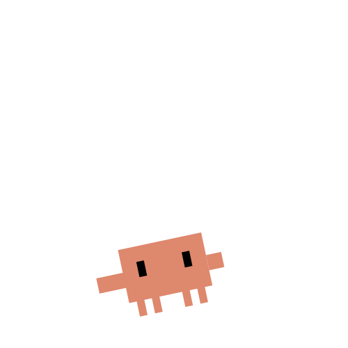

# claude-pet-dsh



把 Claude 桌宠 **Clawd** 接进 **DeepSeek Harness（DSH）** 的 Web / Desktop 界面。它是一个 DSH 客户端插件：

- 在 `shell.overlay` 上显示右下角桌宠；
- 监听 DSH 的 `session/event`（turn / tool / approval / todo）和 `agent/error`；
- 按会话状态切换 `assets/svg/` 里自带 CSS 动画的 Clawd 形象；
- 气泡显示当前任务与 `completed/total` 进度；
- 可拖到窗口内任意位置，单击切换气泡，隐藏后缩成右下角的迷你 Clawd；位置保存在浏览器 `localStorage`。

## 安装

```sh
git clone https://github.com/Jimesarrice/claude-pet-dsh.git
```

在 DSH 环境的终端中注册本地包（把 `<克隆目录>` 换成实际路径）：

```sh
dsh plugin --profile web add file:<克隆目录>
```

桌面版：

```sh
dsh plugin --profile desktop add file:<克隆目录>
```

如果桌面客户端对 desktop profile 有应用内专管限制，请在 DSH 桌面端的插件管理界面选择本地包，或按客户端提示安装。安装后需要重启 DSH（或重开页面）让插件层加载。

## 卸载

```sh
dsh plugin --profile web remove claude-pet-dsh
dsh plugin --profile desktop remove claude-pet-dsh
```

DSH 重启后生效。

## 使用

- 启动后右下角出现 Clawd，默认位置距窗口右下角 24 px。
- 按住角色拖动可放到窗口内任意位置（横向、纵向都到边），松开后记住位置。
- 单击角色切换气泡；“收起”只隐藏气泡，“隐藏”把角色缩成右下角的迷你 Clawd（`MINI` 表映射 `clawd-mini-*`，并跟随当前状态），点它展开回完整形象和动画，位置不变。
- 状态映射：
  - `turn/start` → 工作（`clawd-working-typing`）；
  - `tool/call` → 工作，`ask_user_question` → 等待（`clawd-mini-peek`）；
  - `approval/asked` → 等待；
  - `tool/result` → 工作；
  - `todo/write` → 更新任务标题与 `completed/total`；
  - `turn/end: completed` → 完成（`clawd-happy`，8 秒后回到待机）；
  - `turn/end: error/max-tokens/timeout` → 出错（`clawd-error`）；
  - `turn/end: blocked` → 等待；
  - `agent/error` → 出错；
  - 拖动中 → `clawd-react-drag`。

宿主路由：`GET /claude-pet-dsh/state`、`/claude-pet-dsh/assets/svg/<name>.svg`、`/claude-pet-dsh/health`。

## 自定义角色

`assets/svg/` 里是 45×45 viewBox、自带 CSS 动画的 Clawd 形象。`client.js` 顶部的 `ART` 表决定状态到文件的映射，`CROP`/`SCALE` 控制取景与显示尺寸：

```js
const ART = {
  idle: 'clawd-mini-idle.svg',
  working: 'clawd-working-typing.svg',
  waiting: 'clawd-mini-peek.svg',
  complete: 'clawd-happy.svg',
  error: 'clawd-error.svg',
  connecting: 'clawd-wake.svg',
  offline: 'clawd-sleeping.svg',
  dragging: 'clawd-react-drag.svg'
};
```

换角色时把同名 SVG 放进 `assets/svg/` 即可，动画会随 `` 一起播放。

## 兼容性

- 目标：DSH `0.2.1-rc.5`；已在 `web` profile 加载，`desktop` profile 安装后需重启 DSH 生效。
- 插件不读取对话正文，只消费会话事件中的状态、工具名和 todo 标题。
- 浏览器端使用 DSH 的 `shell.overlay` slot；如果宿主升级改了 slot 名称，需要在 `client.js` 的 `apply()` 里同步调整。
- 这是应用内 overlay，不是独立的操作系统透明悬浮窗。

## 来源与许可

MIT，Copyright (c) 2026 State Interface contributors。Clawd 形象与 SVG 动画取自 State Interface 项目的角色资源，本仓库由该项目的 `dsh-plugin` 改名整理而来；独立社区项目，与 Anthropic 无官方关联。
